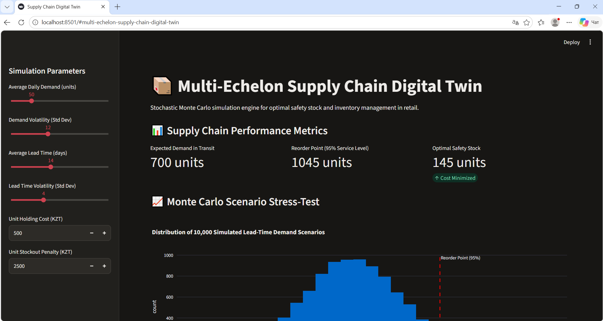
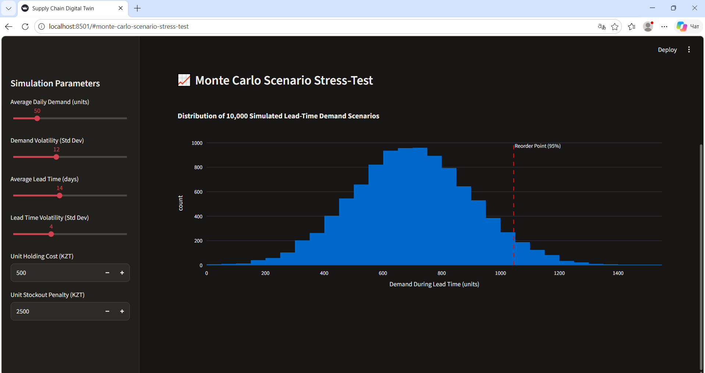

# 📦 Multi-Echelon Supply Chain Digital Twin (Monte Carlo Simulation)

A stochastic **Supply Chain Digital Twin** and inventory optimization engine built with **Python**, **NumPy**, and **Streamlit**. 

Designed for retail and distribution operations (calibrated for Central Asian logistics corridors with cross-border lead-time volatility), this system replaces static average-demand forecasting with a **10,000-scenario Monte Carlo simulation** to compute cost-optimal **Safety Stock** and **Reorder Points**.

---

## 🎯 Problem & Motivation

Traditional inventory models rely on deterministic averages for daily sales and supplier delivery times. In real-world distribution—especially across cross-border supply routes (China, Russia, Europe)—both customer demand and customs/transit lead times are stochastic. Relying on static averages leads to two costly failure modes:

* **Overstocking:** Excess capital locked in slow-moving inventory and warehouse holding costs.
* **Stockouts:** Lost revenue and customer churn during demand spikes or border delays.

This project models lead-time demand as a probability distribution rather than a single point estimate, allowing supply chain managers to stress-test inventory policies against tail risks.

---

## 🖥️ Interactive Dashboard & Stress-Testing

### 1. Real-Time Inventory Optimization Overview


### 2. Stochastic Distribution of 10,000 Lead-Time Demand Scenarios


---

## 🧮 Mathematical & Engineering Architecture

1. **Stochastic Lead-Time Demand Simulation (`simulation.py`):**
   * Generates $N = 10,000$ independent trajectories using vectorized `NumPy` operations.
   * Models daily sales volatility ($\mathcal{N}(\mu_d, \sigma_d)$ truncated at zero) compounded over stochastic supplier lead times ($\mathcal{N}(\mu_L, \sigma_L)$).

2. **Service-Level vs. Cost-Minimization Optimization:**
   * **Service-Level Reorder Point (ROP):** Computes the 95th percentile of the simulated lead-time demand distribution to ensure a 95% cycle service level.
   * **Economic Cost-Optimal Safety Stock:** Evaluates candidate safety stock levels by minimizing total expected inventory cost:
     $$\min_{SS} \; \mathbb{E}[\text{Total Cost}] = \left(SS \times C_{\text{hold}}\right) + \mathbb{E}[\max(0, D_L - (\mathbb{E}[D_L] + SS))] \times C_{\text{stockout}}$$
     where $C_{\text{hold}}$ is the unit holding cost and $C_{\text{stockout}}$ is the unit stockout penalty (calibrated in KZT).

3. **Interactive Sensitivity Sandbox (`app.py`):**
   * Built in **Streamlit** with interactive sliders to simulate operational shocks (e.g., sudden transit delays, demand surges, or shifts in holding/stockout cost ratios).

---

## 📂 Repository Structure

```text
supply-chain-digital-twin/
├── simulation.py          # Core vectorized Monte Carlo engine & cost-minimization solver
├── app.py                 # Interactive Streamlit dashboard & distribution visualizations
├── requirments.txt        # Python dependencies (numpy, streamlit, pandas, plotly)
├── dashboard_preview.png  # Stress-test histogram preview
├── dashboard_preview_2.png# Full metrics & parameters UI preview
└── README.md              # Project documentation

